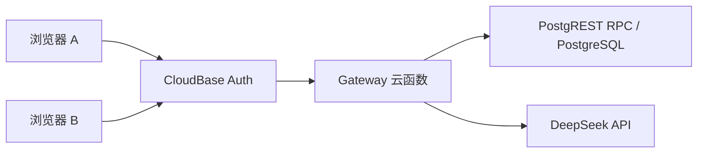

# 共契 · 卡美洛

共契是一个小组共同决策工具。房主建房发邀请，成员先独立写下想法，结束收集后一起看公开意见，再核对候选、独立评价并确认同一版本。没有谈拢时可以保存未达成记录。AI 根据公开内容生成候选或整理分歧，最终结果由成员确认。

[体验卡美洛公网 Demo](https://gongqi-dev-d9grxerai94b966a1-1522916601.tcloudbaseapp.com/camelot-preview/index.html?entrance=1)

## 项目结构

| 目录 | 职责 |
| --- | --- |
| apps/web | React、TypeScript、Vite、Three.js、圆桌骑士及响应式界面 |
| packages/contracts | Zod 请求和快照契约 |
| packages/domain | 评价、揭示与最终确认规则 |
| cloudbase/functions/gateway | CloudBase 身份校验、房间 API、DeepSeek 服务端接入 |
| cloudbase/migrations | PostgreSQL 表、事务 RPC 和数据库权限 |
| tests | 契约、领域与 PostgreSQL 集成测试 |

浏览器使用 CloudBase Auth 获取会话，经 Gateway 和 PostgREST RPC 读写 PostgreSQL。客户端轮询房间快照。服务端按成员与阶段决定哪些字段能公开。

## 本地构建

需要 Node.js 24 和 npm 11。

    npm ci
    npm run typecheck
    npm run build
    npm run test:contracts
    npm run test:domain
    npm run test:domain:v2

将 .env.example 复制为 .env.local，填入自己的 CloudBase 环境 ID、地域和浏览器可发布密钥，再执行 npm run dev。要走完整多人流程，需要自己的 CloudBase PostgreSQL 环境、匿名认证、Gateway 云函数和访问策略。DEEPSEEK_API_KEY 仅供服务端使用。云端配置示例是 cloudbaserc.example.json，实际环境变量需在自己的环境配置。

对本地隔离测试库执行 npm run test:pg:v2 前，先设置 GQ_TEST_DATABASE_URL，并按集成测试中的要求建立相应 PostgreSQL 角色。集成测试会修改测试库结构和数据。请使用可丢弃的本地库。

## 素材与许可

本仓库包含程序化 3D、项目 SVG 和附有 OFL 文本的显示字体。魔法门厅、宫殿、席位背景和开场视频的再分发权待确认，仓库暂缺这些资源。需要完整视觉效果时，可把自有授权的 gate.png、council.png、seat.png、entry.mp4 放到 apps/web/public/camelot/。公网 Demo 可体验现有视觉版本。

项目自研代码采用 [MIT 许可证](LICENSE)。依赖与字体各自遵循上游许可。字体授权文本见 [OFL](apps/web/public/camelot/Noto-Serif-SC-OFL.txt)。
